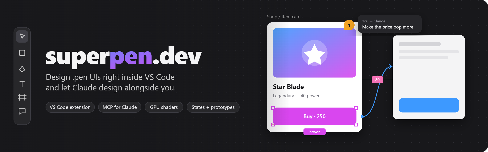

<p align="center">
  
</p>

# superpen.dev

A VS Code extension for designing UIs in `.pen` files (the pen.dev file format), with a pen.dev-style editor:
layers, components, auto layout, variables and themes, script-generated content, GPU shaders, SVG import, and an
MCP server so Claude can design alongside you.

Your `.pen` files stay plain pen.dev JSON, so they keep working in pen.dev too.

---

## Install (2 minutes)

You need **VS Code 1.90 or newer**.

1. Download [`release/superpen.vsix`](release/superpen.vsix) from this repo (open it on GitHub → **Download raw file**).
2. In VS Code open the Extensions view (**Ctrl+Shift+X**), click the **`…`** menu at the top → **Install from VSIX…**,
   and pick the downloaded file.
   *Or* in a terminal: `code --install-extension path\to\superpen.vsix --force`
3. **Ctrl+Shift+P → Reload Window**.

Open any `.pen` file and it opens in the visual editor. There's also a pen button in the editor title bar
(top right) that opens or creates `.pen` files.

> If you also have the official pen.dev extension installed, VS Code may ask which editor to use. Right-click the
> tab → **Reopen Editor With…** to switch.

Try it on the demo: open [`examples/showcase.pen`](examples/showcase.pen) (keep the `scripts/` and `shaders/`
folders next to it — the showcase uses them).

---

## Using Claude with it (optional)

The extension includes an MCP server, so Claude Code chats can read and edit your designs.

1. Install [Claude Code](https://claude.com/claude-code) so the `claude` command works in a terminal.
2. In VS Code: **Ctrl+Shift+P → "Pen Editor: Register MCP Server with Claude Code"** (you're also asked once on
   first start).
3. Start a new Claude chat and ask it to work on one of your open `.pen` files.

How it works:

- `list_open_files` shows every `.pen` file open in any VS Code window.
- `select_file` picks the file a chat works on and takes an **edit lock**, so several chats can each edit a
  different file at the same time without clobbering each other. Other chats can still read it.
- The chat holding the lock is shown at the top right of the editor — click it to revoke the lock.
- Claude can edit with batched operations (one undo step each), take screenshots to check its work,
  check layouts, draw vector artwork (`insert_svg`), trace images into vectors, and write scripts and shaders.
- **Review mode** (checklist button in the tool column): Claude's edits show up straight away but wait in a
  banner until you **Accept** or **Reject** them.
- **Comments** (C): pin a comment anywhere on the canvas. Claude is told about open comments, reads them with
  `get_comments`, does the work and answers in the thread (`reply_comment`).
- **Design lint**: `lint_design` (or the shield button) finds hard-coded colours that should be variables, tiny or
  low-contrast text, fractional positions, overflowing text, missing components and fonts, with one-click fixes.

---

## Features

- **Canvas**: pan (scroll / Space-drag / middle mouse), zoom (Ctrl+scroll, pinch), Shift+1 fit, Shift+2 zoom to
  selection. Very large files stay smooth: off-screen frames are skipped and zoomed-out frames are drawn as images.
- **Editing**: select / deep-select (Ctrl+click), move, resize, draw shapes, text, frames, notes and pen paths,
  auto layout, components and instances, variables and themes, undo/redo through VS Code.
- **Smart guides**: dragged layers snap to the edges and centres of their neighbours and parent, and to equal
  spacing (pink distance labels). Hold Ctrl to move freely. Drag the pink handles between auto-layout children to
  change the gap.
- **Component states**: give a component states like *hover*, *pressed* or *disabled* in the Design panel, edit each
  one on the canvas, and pick which state an instance shows.
- **Prototypes**: link any layer to another frame (Design panel → Prototype) with a transition. In Present mode
  links are clickable and hover/pressed states play automatically.
- **Mixed selections**: select shapes and text together and edit fill, stroke and typography at once; each change
  goes only to the layers it applies to.
- **Find & replace** (Ctrl+F) across text, layer names and variable references.
- **Script nodes**: JavaScript files that generate content (charts, rings, patterns). Inputs show up as controls in
  the Design panel. Shapes menu → **Script** creates a starter file.
- **Shaders**: WebGL fills and effects (`.glsl`) with animation, mouse, shape-aware SDF, content and backdrop
  textures. Settings get sliders and colour pickers automatically.
- **SVG**: paste SVG code or import an `.svg` file and it becomes editable vector shapes. Image fills can be
  traced into vectors (logo / illustration / detailed).
- **Export**: PNG / JPG / SVG / HTML per layer, slides presentation mode.
- **Roblox export (experimental)**: Export → *Roblox Luau* turns a frame into a script that rebuilds it as Roblox
  GUI objects (Frame / TextLabel / ImageLabel with UICorner, UIStroke and UIGradient). Vector art and images become
  placeholders you upload yourself. Claude only uses it (`export_roblox`) when you ask for it.

Editing a `.js` / `.glsl` / image file next to your `.pen` file updates the canvas automatically.

---

## Troubleshooting

- **Something looks broken** → there's a "Reload editor" button if the editor ever hits an error, or
  Ctrl+Shift+P → **Reload Window**. Your document is never lost.
- **Logs**: VS Code → Output panel → **Pen Editor**, or the file `~/.pen-editor/logs/webview.log`.
  A Claude chat can also read the live state with the `diagnose_editor` tool.
- **"claude" not found when registering MCP** → the registration command is copied to your clipboard; run it in a
  terminal where Claude Code is installed.

---

## Building from source

Needs Node.js 18+.

```
npm install
npm run package        # builds and writes release/superpen.vsix
npm start [folder]     # optional: run the editor in a browser against a folder of .pen files (defaults to ./examples)
```

Project layout:

- `src/` – the editor (React): `model/` .pen format, ref/variable resolution, operations and SVG import;
  `render/` canvas renderer, shaders, scripts; `editor/` state, file sync, culling, agent handler; `ui/` panels.
- `extension/` – the VS Code extension (custom editor, per-window MCP bridge with locking) and the MCP server.
- `examples/` – demo design plus its scripts and shaders.
