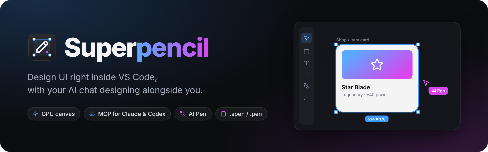

<p align="center">
  
</p>

# Superpencil

**Superpencil** is a VS Code extension for designing UI. Open a `.spen` file (or a pen.dev `.pen` file) and you get a
full visual editor in a tab: layers, components, auto layout, variables and themes, prototypes, vector editing,
shaders and scripts.
It also includes an MCP server, so Claude Code, Codex or any MCP agent can read your designs and edit them while you
watch.

- **Fast on big files.** The canvas is drawn on the graphics card (Skia), so a design with hundreds of screens zooms
  and pans at the screen's refresh rate.
- **Your AI chat is a second designer.** It edits in batches you can undo, takes screenshots to check its own work,
  answers comments pinned on the canvas and draws vector art stroke by stroke with **AI Pen**. No sign-in or API keys:
  it uses the chat you already have.
- **Built-in design skills.** Twelve guides (layout, typography, colour, accessibility, writing, polish, review and
  more, including one against the generic "AI look") that the chat reads before it designs.
- **Bring your work in.** Figma files, layers copied from Figma, web pages, HTML and SVG all import as editable layers.
- **Plain files.** `.spen` is JSON next to your code. It holds exactly what pen.dev's `.pen` holds, so both open
  directly and convert either way without losing anything.

**Contents:** [Install](#install-2-minutes) · [Use it with Claude or Codex](#use-it-with-claude-or-codex-optional) ·
[Features](#features) · [Big files](#big-files) · [Troubleshooting](#troubleshooting) · [What's new](#whats-new) ·
[Building from source](#building-from-source)

---

## Install (2 minutes)

You need **VS Code 1.90 or newer**.

1. Download [`release/superpen.vsix`](release/superpen.vsix) from this repo (open it on GitHub → **Download raw file**).
2. In VS Code open the Extensions view (**Ctrl+Shift+X**), click the **`…`** menu at the top → **Install from VSIX…**,
   and pick the downloaded file.
   *Or* in a terminal: `code --install-extension path\to\superpen.vsix --force`
3. **Ctrl+Shift+P → Reload Window**.

It shows up in the Extensions list as **Superpencil**. Open any `.spen` or `.pen` file and it opens in the visual
editor. The Superpencil icon in the activity bar (left) lists your workspace's designs, and the pen button in the
editor title bar (top right) opens or creates one.

To update, install the newer `superpen.vsix` the same way and reload the window.

> If you also have the official pen.dev extension installed, VS Code may ask which editor to use. Right-click the
> tab → **Reopen Editor With…** to switch.

**Try the demo:** open [`examples/showcase.spen`](examples/showcase.spen) (keep the `scripts/` and `shaders/` folders
next to it; the showcase uses them). It is a guided tour: things to try, live scripts, shaders, components, file
formats and AI.

---

## Use it with Claude or Codex (optional)

1. Install [Claude Code](https://claude.com/claude-code) so the `claude` command works in a terminal.
2. In VS Code: **Ctrl+Shift+P → "Superpencil: Register MCP Server with Claude Code"** (you are also asked once on
   first start). With Node.js installed this also adds a small hook to `~/.claude/settings.json` (a `.bak` copy is
   kept) that tells Claude about AI Pen requests waiting on the canvas.
3. Start a new Claude chat and ask it to work on one of your open designs.

**Using Codex?** Run **Ctrl+Shift+P → "Superpencil: Register MCP Server with Codex"**. It adds a
`[mcp_servers.pen-editor]` entry to `~/.codex/config.toml` (or `$CODEX_HOME/config.toml`), keeping a `.bak` copy of
the old file, then works the same way in a new Codex chat.

How working together goes:

- **One chat per file.** A chat picks a file and takes its **edit lock**, so several chats can each edit a different
  design at once without clobbering each other; other chats can still read it. The chat holding the lock is shown at
  the top right of the editor. Click it to take the lock away.
- **Edits you can undo.** Each batch of the chat's changes is one undo step.
- **It checks its work.** The chat can screenshot any layer, check layouts for overflow and clipping, and lint the
  design.
- **Review mode** (**…** menu in the top bar → *Review AI edits before they apply*): the chat's edits show up
  straight away but wait in a banner until you **Accept** or **Reject** them.
- **Comments** (C): pin a comment anywhere on the canvas. The chat is told about open comments, does the work and
  answers in the thread.
- **AI Pen** (Shift+P): drag a box, describe a drawing, and the chat draws it in passes while you watch each stroke.
  Put a reference image under the box and it measures the image and matches it. If the chat is idle, tell it "draw my
  AI Pen requests".
- **Sections.** On big files the chat groups frames into sections and shows only the ones it is working on.

### Design skills

The MCP server carries twelve design skills, written for this editor. A chat loads the ones that fit before it
designs, restyles or reviews, and runs each skill's checklist before it calls the work finished:

| Skill | What it covers |
|---|---|
| `un-ai` | Avoiding the generic machine-made look: the tells, and what to do instead |
| `interface` | What goes on a screen, flows, states (empty, loading, error), forms, dialogs |
| `layout` | Spacing scale, grouping, alignment, sizes for phone, desktop and game HUDs |
| `typography` | Type scale, weights, line height, measure, choosing fonts |
| `colors` | Neutrals, one accent, status colours, contrast, dark themes |
| `ui` | Buttons, inputs, cards, depth, icons, component states |
| `writing` | Labels, errors, empty states, realistic content |
| `transitions` | Motion: durations, easing, which transition for which navigation |
| `transitions-dev` | Motion specs for developers, with CSS and Roblox TweenService examples |
| `accessibility` | WCAG 2.2 AA: contrast, target sizes, focus, colour-blind-safe choices |
| `polish` | The finishing pass, in order |
| `interface-review` | A structured critique with ranked findings |

You do not have to do anything: the chat is told to use them. To start one yourself, the skills are also in the
chat's slash menu (in Claude Code: `/mcp__pen-editor__polish`, `/mcp__pen-editor__interface-review`, and so on), or
just say "polish this" or "review this screen".

---

## Features

**Canvas**
- Pan (scroll, Space-drag, middle mouse), zoom (Ctrl+scroll, pinch), Shift+1 fit, Shift+2 zoom to selection.
- Select, deep-select (Ctrl+click), move, resize, draw shapes, text, frames, notes and pen paths. Undo and redo go
  through VS Code.
- **Smart guides**: dragged layers snap to the edges and centres of their neighbours and parent, and to equal
  spacing. Hold Ctrl to move freely. Drag the pink handles between auto-layout children to change the gap.
- **Scale** (K): resize a layer together with everything in it: text, strokes, corner radii, gaps, padding and
  effects. Drag a handle, or type a percentage in the Design panel.
- **Measure**: hold Alt and hover another layer to read the distances between it and the selection.
- **Eyedropper** (I): click a layer to copy its colour, or apply it to the selection (Shift: as stroke).
- **Find & replace** (Ctrl+F) across text, layer names and variable references.
- **Mixed selections**: select shapes and text together and edit fill, stroke and typography at once.

**Design system**
- **Auto layout**, **components and instances**, **variables and themes**.
- **Slots**: mark a frame inside a component as a slot, and each instance fills it with its own content (a card's
  body, a dialog's buttons). Suggested components can be inserted with one click.
- **Libraries**: use another design file's components and variables in this one (left panel → **Libraries**). They
  stay linked to the library file.
- **Component states**: give a component states like *hover*, *pressed* or *disabled*, edit each one on the canvas,
  and pick which one an instance shows.
- **Prototypes**: link any layer to another frame with a transition. In Present mode links are clickable and
  hover/pressed states play by themselves.
- **Design lint** (**…** menu in the top bar): finds hard-coded colours that should be variables, tiny or low-contrast text,
  fractional positions, overflowing text, missing components and fonts, with one-click fixes.

**Generated and animated content**
- **Script nodes**: JavaScript files that generate layers (charts, rings, patterns). Their inputs show up as controls
  in the Design panel. Shapes menu → **Script** creates a starter file.
- **Shaders**: WebGL fills and effects (`.glsl`) with animation, mouse position, shape-aware distance fields, and the
  layer's content or backdrop as textures. Settings get sliders and colour pickers automatically.
- Editing a `.js`, `.glsl` or image file next to your design updates the canvas by itself.

**Vectors and images**
- **Pen tool** (P): click for corners, click and drag for curves. Double-click a path (or select it and press Enter)
  to edit its points: move anchors and handles, click the outline to add a point, double-click a point to switch
  between smooth and corner, Delete to remove it.
- **Gradients on the canvas**: with a gradient fill open, drag its ends, stops, centre and radius directly on the
  layer. **Mesh gradients** have a grid of colour points you can move and bend.
- **Masks**: tick *Use as mask* on a shape and it clips the layers above it in the same group.
- **Image crop**: *Crop* on an image fill, then drag the picture or the handles; *Reset crop* undoes it.
- **Remove background**: makes a plain or gently graded background transparent. It is built in, nothing is
  downloaded and no AI model is involved, so it is meant for icons, renders and product shots, not busy photos.
- **AI Pen** (Shift+P): described above. Select a drawing to ask for changes.
- **SVG**: paste SVG code or import an `.svg` file and it becomes editable vector shapes. Image fills can be traced
  into vectors (logo / illustration / detailed).

**Import**
- **Figma**: Shapes menu → *Import Figma file…* takes a `.fig` file (in Figma: File → Save local copy) and imports
  a page as editable layers: auto layout, text, vectors, pictures, shadows, masks and crops. Or copy layers in Figma
  and paste them here. Component instances come in as plain layers; prototype links and variables are not imported.
- **Web pages and HTML**: Shapes menu → *Import web page or HTML…* takes a web address, pasted HTML or an `.html`
  file and turns every visible element into a layer. Scripts are not run, so pages built by JavaScript may come in
  empty.

**Export**
- PNG / JPG / SVG / HTML per layer, and a slides presentation mode.
- **Roblox Luau (experimental)**: Export → *Roblox Luau* turns a frame into a script that rebuilds it as Roblox GUI
  objects (Frame / TextLabel / ImageLabel with UICorner, UIStroke and UIGradient). Vector art and images become
  placeholders you upload yourself. An AI chat only uses it when you ask.

---

## Big files

- **GPU canvas (since 0.4.0).** Frames are drawn by Skia on the graphics card instead of as thousands of page
  elements. Frames with shader fills, and a frame whose text you are editing, are drawn the previous way. If the
  graphics card can't run it, the editor switches back to the previous renderer by itself and says so once.
- **Sections.** Group top-level frames into named sections (ask your chat to "group my frames into sections"). Hide or
  show whole sections from the **Sections** tab in the left panel; hidden frames aren't drawn at all. The zoom menu
  (the percentage in the top bar) switches to the **Sections** viewer, which shows one section at a time like slides.
- **Performance mode** (in the zoom menu), for PCs with little memory or a weak GPU: pictures
  use half the resolution, shader animation runs slower, and designs in background tabs let go of their frames. It
  turns on by itself the first time on PCs with 16 GB of memory or less.
- **Frame rate.** Press **F8** for a small FPS readout at the bottom left; press it again to hide it.
- **Measure it.** Ask your chat to "run the benchmark": it times zooming and panning on your own design and reports
  the numbers.

---

## Troubleshooting

- **Something looks broken** → use the "Reload editor" button if the editor shows an error, or Ctrl+Shift+P →
  **Reload Window**. Your document is never lost.
- **Something is drawn wrong** → ask your AI chat to "set the renderer to dom". That switches this editor back to the
  renderer used before 0.4.0 ("set the renderer to full" switches back). Please open an issue with a screenshot.
- **Logs**: VS Code → Output panel → **Superpencil**, or the file `~/.pen-editor/logs/webview.log`. A chat can also
  read the live state with the `diagnose_editor` tool.
- **"claude" not found when registering MCP** → the registration command is copied to your clipboard; run it in a
  terminal where Claude Code is installed.
- **Is it safe / will antivirus mind?** The extension is plain JavaScript and WebAssembly (no `.exe` or native code).
  Its only network server listens on `127.0.0.1` (your own PC) so chats can reach the editor, it writes only to
  `~/.pen-editor`, and the only commands it runs are `node --version` and `claude mcp add/remove` when you register
  the MCP server. If Node.js isn't installed it starts the MCP server with VS Code's own runtime
  (`ELECTRON_RUN_AS_NODE`), which some strict corporate security tools flag; installing Node.js avoids that.

---

## What's new

### 1.0.0
- **Design skills**: twelve built-in guides the chat reads before designing (see
  [Design skills](#design-skills)), including `un-ai`, against the generic machine-made look.
- **Figma import**: `.fig` files and layers copied from Figma.
- **HTML import**: a web address, pasted HTML or an `.html` file becomes editable layers.
- **Pen tool**: draw curves, and edit a path's points afterwards.
- **Gradients edited on the canvas**, and real **mesh gradients**.
- **Scale tool** (K) scales text, strokes, radii and effects with the layer.
- **Measurements**: Alt + hover shows distances between layers.
- **Libraries**: use another design file's components and variables.
- **Component slots**.
- **Masks**, **image crop** and built-in **remove background**.
- New MCP tools: `list_design_skills`, `get_design_skill`, `import_figma`, `import_html`, `remove_background`, and a
  `scale` operation in `apply_operations`.

### 0.4.0
- **New canvas renderer, much faster on big designs.** Frames are drawn on the graphics card with Skia (the graphics
  engine Chrome uses). On a 319-frame design with every section shown, zooming in used to stall for up to 0.8 s; it
  now stays around 20 ms a frame, and zooming out and panning run at the screen's refresh rate.
- **Less memory.** The same design takes about 100–250 MB less while you work in it. Pictures load small first and
  sharpen a moment after you zoom in on them.
- Selecting, deep-select, text editing, AI Pen, screenshots and exports work as before.
- **Redesigned interface.** One slim top bar holds the tools, the zoom menu and Present; the layers and design
  panels are attached to the window edges; colours are neutral with a single blue accent. Less-used tools (notes,
  variables, find & replace, lint, review mode, shortcuts, settings) are under the **…** button, and performance
  mode and the Sections viewer are in the zoom menu.
- **F8** shows a small frame-rate (FPS) readout at the bottom left.
- New MCP tools: `benchmark` (times zooming and panning on your own design) and `set_renderer` (switches between the
  new renderer and the previous one).
- New banner and icon, and this README was rewritten.

### 0.3.1
- **Fix: frames going invisible when zoomed far out** after a graphics hiccup.
- Designs in background tabs let go of their frames after five minutes (20 seconds in performance mode) and load them
  again when shown.

### 0.3.0
- **AI Pen** (Shift+P), with a hook so drawing requests are never missed, and `ai_pen_wait` for chats that keep
  drawing as you ask.
- **Remaking a reference 1:1**: `analyze_image` measures a reference image exactly; `compare_to_reference` scores a
  drawing against it. `check_drawing` finds stroke ends that stop just off the line they meet.
- **Sharp vector art when zoomed in**, **pictures that no longer bog down zooming**, smoother zooming out.
- **Performance mode**.
- Fixes: screenshots of background tabs no longer hang; vertical and horizontal lines in imported SVGs no longer
  disappear.

### 0.2.1
- **Sections** and the **Sections viewer**, with MCP tools so a chat keeps big files light.
- Image-heavy files: zoomed-out snapshots appear about 3× faster; web images no longer vanish below 33% zoom.

### 0.2.0
- **Eyedropper** (I), **`.spen` files** with **Save a Copy as .pen / .spen**, a new showcase, **Codex support**.
- New name and icon: the extension is called **Superpencil** (it was "Pen Editor (Remake)").
- A **Designs** list in the activity bar.

---

## Building from source

Needs Node.js 18+.

```
npm install
npm run package        # builds and writes release/superpen.vsix
npm start [folder]     # optional: run the editor in a browser against a folder of .spen/.pen files (defaults to ./examples)
```

Set `PEN_PROD=1` before `npm start` to serve the production build instead of the dev server (useful for measuring
performance, since React's dev mode is much slower).

Project layout:

- `src/` – the editor (React). `model/` file format, variables, operations and SVG import; `skia/` the GPU renderer;
  `layout/` the layout engine it uses; `render/` the previous renderer, shaders and scripts; `editor/` state, file
  sync and the agent handler; `import/` Figma and HTML import; `ui/` panels.
- `extension/` – the VS Code extension (custom editor, per-window MCP bridge with locking), the MCP server, and
  `skills/`, the design skills as Markdown.
- `tests/` – browser-driven test suites and measuring scripts ([tests/README.md](tests/README.md)).
- `docs/` – [SKIA_REWORK.md](docs/SKIA_REWORK.md), the plan and log of the renderer rework.
- `examples/` – the demo design with its scripts and shaders.
- `media/` – icons, and `banner.spen`, the banner's source (made in Superpencil).
